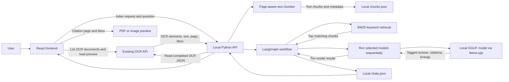

# JRF Task — Local Hugging Face document Q&A

This repository contains a local React frontend and Python backend for asking
questions about completed OCR documents. The backend retrieves OCR output from the
existing OCR API, indexes its text locally, searches relevant passages, and asks
one or more locally stored GGUF models to answer with citations. The OCR application
and its storage are read-only dependencies; this project does not change them.

## What runs locally

- **Frontend:** React and Vite, served at `http://localhost:3000`.
- **Backend:** Python HTTP API, served at `http://127.0.0.1:8787`.
- **Answer models:** GGUF files discovered from the local model folder and run on
  the CPU through `llama.cpp` and LangChain's `ChatLlamaCpp` integration. The
  current folder contains Qwen2.5 1.5B, Qwen2.5 7B, DeepSeek-R1-Distill-Qwen 7B,
  and Meta-Llama 3.1 8B.
- **Model comparison:** select up to four models. Each receives the same question
  and retrieved OCR passages in sequence; each response is tagged with the model
  name and includes its load and inference timings.
- **Search:** local BM25 keyword ranking over OCR text chunks. This version does
  not create embeddings and does not use a vector database.
- **Local data:** JSON files for indexed chunks and conversation history.
- **OCR input and previews:** read from the existing OCR API. The API must be
  reachable, and its CORS configuration must allow the local frontend origin for
  browser requests.

Model files are stored separately from this repository in:

```text
~/Documents/Balaji-JRF Works/LLM(models) from HuggingFace/
```

`LOCAL_MODEL_DIR` tells the backend where to discover `.gguf` files. The base
Qwen file was moved from `~/models/jrf-task-llm/` into this shared model folder.
The default local data directory is:

```text
~/.local/share/jrf-task-llm/
├── chunks.json
└── chats.json
```

Set `JRF_TASK_LLM_DATA_DIR` to use a different directory.

## End-to-end flow



### 1. Select and fetch OCR data

The frontend loads the list of completed OCR documents from the existing OCR API.
When a document is indexed, `indexing.py` asks that API for the document metadata
and its OCR JSON URL. `ocr_source.py` fetches the OCR JSON and returns the document
elements to the local backend. The Q&A backend does not update the source OCR
records.

### 2. Chunk and preserve source positions

`chunker.py` normalizes whitespace, groups OCR text by page, and combines elements
into chunks of roughly 1,400 characters. A chunk never crosses a page boundary.
Each chunk keeps its document ID, filename, page number, text, and merged bounding
box. Bounding boxes are normalized coordinates in the OCR page (values from 0 to
1); invalid or missing boxes are stored as `null`.

### 3. Persist and search locally

`vector_store.py` replaces the selected document's old chunks in `chunks.json`.
Despite the historical module name, this is **not** a vector or embedding store:
the implementation tokenizes text and ranks chunks with a BM25-style lexical
score. At question time it searches only the selected, already indexed documents
and returns the highest-scoring passages (five by default, at most eight).

### 4. Generate one or more cited answers

`chat_graph.py` coordinates retrieval, model execution, and history persistence.
It retrieves the recent four conversation turns and matching chunks, then calls
`local_model.py` once per selected model. The selected GGUF is loaded from
`LOCAL_MODEL_DIR` through `ChatLlamaCpp`; only one model stays loaded at a time
to limit memory. Inference runs on CPU (`n_gpu_layers=0`), uses an 8,192-token
context, and generates up to 700 tokens by default. All selected models receive
the same question and passages. Each response has a clear model ID/display name,
citations, and load/inference performance fields. A failed model is recorded
separately without discarding successful results from the other models.

### 5. Save history and show citations

`chat_store.py` saves chat metadata and turns, including timestamps, the question,
selected and retrieved document IDs, all selected model IDs, each tagged model
answer, retrieved text, page,
bounding box, and retrieval score. `local_storage.py` writes JSON atomically with
private file permissions. The frontend displays cited sources. Selecting a source
opens the OCR document preview at its cited page and overlays its normalized
bounding box.

### Example

For example, select a completed heat-wave action-plan PDF in the UI and choose
**Index selected OCR documents**. The backend fetches its OCR JSON, groups the
page's text elements into chunks, and saves those chunks in `chunks.json`. Select
Qwen2.5 7B and Llama 3.1 8B, then ask “What actions should be taken during a heat
wave?” The same BM25 passages are sent to both models in sequence. Their separately
tagged answers and performance metrics appear in responsive result cards. Each
answer has its own citation buttons for the corresponding page and bbox. The
question and every model result are saved in one turn in `chats.json`.

## Start the application

Follow [`Commands.md`](./Commands.md) for first-time setup, model download,
starting both services in separate terminals, health checks, example API calls,
and troubleshooting. After initial setup, the usual workflow is:

1. Start the backend in Terminal 1.
2. Start Vite in Terminal 2.
3. Open `http://localhost:3000`, select an OCR document, index it, and ask a
   question.

## Project map

| Path | Responsibility |
|---|---|
| [`backend/BackendREADME.md`](./backend/BackendREADME.md) | Backend request flow, every backend module, tests, API routes, and a worked example |
| [`backend/jrf_task_llm/`](./backend/jrf_task_llm/) | Local Python API, OCR retrieval, chunking, BM25, Qwen inference, and history |
| [`backend/tests/`](./backend/tests/) | Unit tests for the local backend pipeline |
| [`frontend/FrontendREADME.md`](./frontend/FrontendREADME.md) | Frontend behavior, component map, and browser-to-backend flow |
| [`frontend/src/`](./frontend/src/) | React UI, API clients, history, document preview, and styles |
| [`Commands.md`](./Commands.md) | Repeatable local setup and run commands |

## Scope and current limitations

- GGUF models are discovered directly inside `LOCAL_MODEL_DIR`; the current API
  accepts up to four model selections per comparison.
- Model comparison is sequential on the CPU. Switching models unloads the previous
  model before loading the next; first-answer load time differs from later reuse.
- Retrieval is lexical BM25, not semantic/embedding search. Different wording from
  the OCR text may retrieve less effectively.
- Selected text models receive OCR text chunks. Detected figure/image crops are
  not sent to these text-only models.
- The OCR API and document preview service must remain reachable. If browser
  requests fail, the OCR API must allow the frontend origin (usually
  `http://localhost:3000`) in its CORS configuration.
- `chunks.json` and `chats.json` persist between backend restarts. In-memory job
  status does not; restart the backend and submit a new request if a job ID is no
  longer found.
- This is a local research/demo workflow, not an authenticated multi-user service.
- No cloud deployment steps are part of this local guide.
