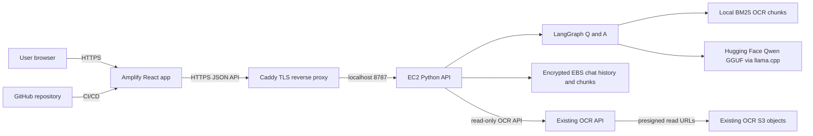

# JRF Task — Hugging Face document Q&A

Standalone React application and Python API for question answering over existing OCR
documents. The answer model is the Qwen2.5-1.5B-Instruct GGUF from Hugging Face,
served with `llama.cpp` on a CPU EC2 instance. LangGraph coordinates retrieval,
answer generation, and chat-history persistence; BM25 searches OCR text chunks and
citations retain the original page and bounding box.

This is a separate application. It reads completed documents and preview URLs from
the existing OCR API. It does not modify OCR Lambdas, storage, API routes, React
application, or router.

## Request and deployment flow

Amplify serves the React build; EC2 keeps the model loaded and runs retrieval and
chat. Caddy supplies HTTPS for the API domain and forwards requests to the API on
loopback. The browser calls the API directly using
`VITE_JRF_TASK_LLM_API_URL`; no AWS credentials are put in frontend code.

**Testing access:** restrict API HTTPS ingress to the tester IP addresses in the
EC2 security group. CORS is configured for the exact Amplify origin. CORS is not
authentication; IP filtering is only a temporary single-team test control, not
production user authentication. See
[`docs/AWS-DEPLOYMENT-PLAN.md`](./docs/AWS-DEPLOYMENT-PLAN.md) before making the
service generally public.

## Deploy and test

Follow the commands and ordered steps in
[`docs/AWS-DEPLOYMENT-PLAN.md`](./docs/AWS-DEPLOYMENT-PLAN.md). The intended
staging setup is one `m7i.large` EC2 instance, encrypted EBS, Systems Manager access,
Caddy-managed HTTPS, and an Amplify frontend. The API Gateway service is intentionally
not in the first deployment: Amplify can call the HTTPS API hostname directly, while
an extra gateway adds cost and another configuration layer without helping this
single-backend test.

Before deployment, confirm the AWS CLI identity/region, the API DNS name, the
Amplify branch origin, the allowed tester IPs, and a one-day spending limit. No
infrastructure is created by running the application scripts alone.

## Project map

### Backend (`backend/`)

| File | Purpose |
|---|---|
| `jrf_task_llm/local_server.py` | HTTP routes, request validation, CORS, and job results |
| `jrf_task_llm/local_model.py` | Loads the single Qwen GGUF model and formats answer citations |
| `jrf_task_llm/chat_graph.py` | LangGraph retrieval → answer → history workflow |
| `jrf_task_llm/chunker.py` | OCR text chunking with page and bbox metadata |
| `jrf_task_llm/vector_store.py` | JSON chunk persistence and BM25 lexical search |
| `jrf_task_llm/chat_store.py` | JSON conversation and turn persistence |
| `jrf_task_llm/ocr_source.py` | Read-only completed OCR document retrieval |
| `jrf_task_llm/indexing.py` | Fetches OCR JSON and stores generated text chunks |
| `jrf_task_llm/local_storage.py` | Atomic, user-private JSON file reads/writes |
| `deploy/install-ec2.sh` | Installs the API/model service and Caddy on Ubuntu EC2 |
| `deploy/ec2-trust-policy.json` | EC2 instance role trust relationship for SSM management |
| `requirements.txt` | Python, LangGraph, Hugging Face CLI, and llama.cpp packages |
| `tests/` | Unit tests for Q&A, citations, retrieval, storage, and API routes |

### Frontend (`frontend/`)

| File | Purpose |
|---|---|
| `src/main.jsx` | Reads Amplify build-time API URL settings and starts React |
| `src/components/LLMTab.jsx` | Document selection, indexing, Q&A, and retrieved sources |
| `src/components/HistoryOfLLMChat.jsx` | Opens saved conversations from the API |
| `src/components/LLMComparePane.jsx` | Renders the cited OCR document page and bbox highlight |
| `src/llmApi.js` | Calls the Q&A API and read-only OCR API |
| `src/components/llm.css` | Workspace layout and independent chat/document scrolling |
| `package.json` / `package-lock.json` | React, Vite, and PDF viewer dependencies |

## Important boundaries

- The model runs on the EC2 CPU; model files and local JSON data reside on encrypted
  EBS. Back up or export chat history before replacing the instance.
- The initial API supports one configured Qwen model. It is not an authentication
  service and should remain IP-restricted during today's test.
- Indexing uses OCR text. Figure crops are not passed to this text model.
- The current design is a single-instance demonstration, not a highly available
  multi-user deployment. Its in-memory job state is lost if the process restarts.
- Stop or terminate test resources when finished and verify that any Elastic IP or
  other billable resources are released.
