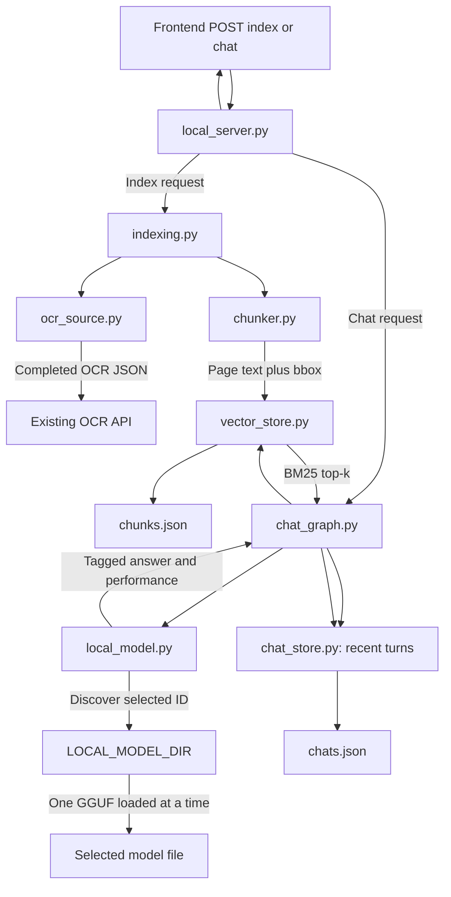

# Local Qwen document-Q&A backend

The backend is a local Python HTTP API. It reads completed OCR output through the
existing OCR API, creates page-aware text chunks, stores them in JSON, retrieves
relevant chunks using BM25 keyword ranking, calls one or more local GGUF models,
and saves conversations and source metadata to local JSON.

It does not modify the OCR API or its storage. It does not create vector embeddings
or use a vector database: `vector_store.py` is the current local lexical/BM25
chunk store.

## Backend request flow



### Worked example

Suppose the UI requests indexing for one completed OCR document:

1. `local_server.py` validates its document ID and calls `indexing.index_document`.
2. `ocr_source.fetch_ocr_document` calls the configured OCR API's
   `/document/{document_id}` endpoint, obtains the OCR JSON URL, and fetches its
   elements. It requires the OCR record to be completed.
3. `chunker.chunk_document` normalizes the OCR text and groups elements by page,
   producing chunks up to about 1,400 characters. Each chunk carries the document
   ID, filename, page, text, and merged normalized bbox.
4. `vector_store.replace_document_chunks` replaces that document's previous local
   chunks in `chunks.json`.
5. When the user asks a question about that document, `chat_graph.retrieve_context`
   searches only its indexed chunks and picks the best BM25 matches. Every selected
   model receives the same retrieved passages.
6. `local_model.answer_question` sends those excerpts, the question, and up to
   four recent turns to each selected model in order. Model IDs derive from their
   filenames. The previous GGUF is explicitly closed before the next is loaded to
   limit RAM use. Each model's `[S1]` citations are matched to page/bbox metadata.
7. `chat_graph.persist_result` records the question, selected model IDs, each
   separately tagged answer or error, selected and fetched documents, retrieved
   text, scores, citation metadata, and timestamps through `chat_store.py` in
   `chats.json`.
8. The API returns per-model results and a `complete`, `partial`, or `failed`
   status; the frontend shows a labeled card for each model and opens the source
   page/bbox.

## Model location and loading

GGUF files are stored outside the repository in:

```text
~/Documents/Balaji-JRF Works/LLM(models) from HuggingFace/
```

`LOCAL_MODEL_DIR` overrides this folder. `/api/models` lists `.gguf` files directly
inside it. Adding or removing models requires restarting the backend. The base
Qwen model keeps its legacy ID `Qwen2.5-1.5B-Instruct-Q4_K_M`; other IDs use their
filename stem.

`local_model._load_model` loads a selected file through LangChain's
`ChatLlamaCpp` integration on demand. Only one model stays loaded; switching
explicitly closes the previous llama.cpp client before loading the next. Current
inference uses CPU (`n_gpu_layers=0`), eight threads by default, an 8,192-token
context, temperature 0.2, and a maximum of 700 generated tokens. Inference is
serialized with a lock. The legacy `LOCAL_CHAT_MODEL_PATH` can add one model from
outside the model folder.

See [`../Commands.md`](../Commands.md) for install, download, start, and test
commands.

## Local persistence

By default, `JRF_TASK_LLM_DATA_DIR` resolves to:

```text
~/.local/share/jrf-task-llm/
├── chunks.json
└── chats.json
```

`chunks.json` contains text and source-location metadata used by lexical retrieval.
`chats.json` contains conversations and retrieved excerpts. Both survive backend
restarts. Job results are held in process memory and do not survive a restart.
Override the data folder with `JRF_TASK_LLM_DATA_DIR`.

## Backend files and use cases

### Application modules

| File | Responsibility and use case |
|---|---|
| `jrf_task_llm/__init__.py` | Marks `jrf_task_llm` as a Python package so it can be started with `python -m jrf_task_llm.local_server`. |
| `jrf_task_llm/config.py` | Reads environment configuration: OCR API URL, model directory/path, local host/port, data folder, thread/context settings, allowed browser origins, and retrieval limits. |
| `jrf_task_llm/local_server.py` | Local HTTP API, input validation, CORS, route dispatch, and in-memory job status. For example, `POST /api/documents/index` validates IDs and starts the indexing operation. |
| `jrf_task_llm/ocr_source.py` | Read-only HTTP client for OCR metadata and OCR JSON. For example, it rejects a document that is not completed or lacks an OCR JSON URL. |
| `jrf_task_llm/indexing.py` | Orchestrates fetching, chunking, and storing one document. It returns the document name and number of chunks indexed. |
| `jrf_task_llm/chunker.py` | Turns OCR elements into page-local text chunks while retaining a stable chunk ID and merged bbox. For example, elements from page 4 are never merged into a page 5 chunk. |
| `jrf_task_llm/vector_store.py` | Persists chunks in `chunks.json` and ranks them with a BM25-style lexical score. The name is historical; it is not a vector database and stores no embeddings. |
| `jrf_task_llm/chat_graph.py` | LangGraph orchestration of recent history + retrieval → answer generation → persisted result. |
| `jrf_task_llm/local_model.py` | Discovers GGUF files, validates up to four selections, switches the active `ChatLlamaCpp` model, builds grounded prompts, maps source labels to citations, and measures performance. |
| `jrf_task_llm/chat_store.py` | Creates conversations, appends timestamped turns, preserves all model IDs used in a chat, lists history, and returns prior messages and sources. |
| `jrf_task_llm/local_storage.py` | Shared JSON read/write helpers. Writes use a temporary file and atomic replacement with private file permissions. |

### Project/support files

| File | Responsibility |
|---|---|
| `requirements.txt` | Python dependencies, including LangGraph, LangChain community integrations, Hugging Face Hub, and `llama-cpp-python`. |
| `BackendREADME.md` | Backend architecture, module map, local data locations, and examples. |
| `tests/test_chunker.py` | Page grouping, chunk limits, stable IDs, and bbox handling. |
| `tests/test_local_vector_store.py` | Chunk persistence, document replacement, and BM25 result ranking. |
| `tests/test_ocr_source.py` | OCR service URL parsing, completed-document checks, and errors. |
| `tests/test_local_model.py` | Model selection, prompt context, source citations, and response mapping without requiring a live model call. |
| `tests/test_chat_graph.py` | Retrieval → answer → history workflow and persisted result shape. |
| `tests/test_chat_store.py` | Chat metadata, turns, timestamps, and read/list behavior. |
| `tests/test_local_server.py` | API routes, request validation, jobs, and local CORS behavior. |

## API routes

| Method | Path | Purpose |
|---|---|---|
| `GET` | `/api/health` | Confirms the local API process is responding. |
| `GET` | `/api/models` | Lists discovered GGUF models with ID, display name, filename, and size. |
| `POST` | `/api/documents/index` | Fetches, chunks, and stores up to three completed OCR documents. |
| `GET` | `/api/documents/index/{job_id}` | Reads the result of a previous indexing request in this process. |
| `POST` | `/api/chat` | Retrieves context, calls each selected model, and saves tagged answers. |
| `GET` | `/api/chat-jobs/{job_id}` | Reads the result of a previous chat request in this process. |
| `GET` | `/api/chats` | Lists saved conversation summaries. |
| `GET` | `/api/chats/{chat_id}` | Returns conversation turns and their saved source metadata. |

Select up to four models for comparison. Index/chat processing currently completes
inside the POST request handler, even
though the response first returns a job ID with `processing`; the frontend then
fetches that job result. Job state is held in memory.

## Tests

From the `backend/` folder, with its virtual environment active:

```bash
PYTHONPATH=. python -m unittest discover -s tests -v
python -m compileall -q jrf_task_llm tests
```

The tests mock OCR/model boundaries where appropriate and do not require downloading
or loading the GGUF model.
