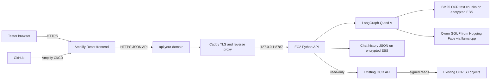

# EC2 Qwen backend and Amplify deployment

**Purpose:** a one-day, low-volume staging deployment for two or three testers.
This guide does not deploy anything automatically. Check the AWS region, available
domain, current tester IP addresses, account access, and spending limit before
running the commands. Stop or terminate the EC2 instance after the demonstration.

## Current staging deployment

The following resources are already running in account `433448338709`, region
`ap-southeast-2`:

| Component | Current value |
|---|---|
| Frontend | [https://main.d326ha2ayic9km.amplifyapp.com](https://main.d326ha2ayic9km.amplifyapp.com) |
| Amplify app / branch | `d326ha2ayic9km` / `main` |
| Backend API | [https://api-jrf-llm-pipeline.skillrouteai.com/api/health](https://api-jrf-llm-pipeline.skillrouteai.com/api/health) |
| EC2 instance | `i-005c4103fae0b04c9` (`m7i.large`, 2 vCPU / 8 GiB) |
| EC2 public address | `3.107.163.225` |
| Security group | `sg-000441cccebd5a693` |
| Model | Qwen2.5-1.5B-Instruct-Q4_K_M GGUF |
| Backend CORS origin | `https://main.d326ha2ayic9km.amplifyapp.com` |

The Amplify artifact was uploaded manually from `frontend/dist`; the app is not
connected to GitHub and automatic branch builds are disabled. The API currently
allows HTTPS only from the confirmed tester `/32`; port 80 is open for Caddy's
HTTP redirect and certificate validation. The existing
`jrf-llm-pipeline.skillrouteai.com` hostname was left unchanged. Use the Amplify
branch URL above for the new frontend. No Elastic IP is attached, so stopping and
starting the instance can change its public address; update the API A record if
that happens.

The AWS Price List currently reports `$0.126/hour` for this EC2 instance type in
Sydney (about `$3.02` for 24 hours). The encrypted 30-GiB gp3 volume, public IPv4,
data transfer, taxes, and Amplify usage are additional; actual charges vary.
Terminate the EC2 instance after the demonstration to stay within the approved
one-day budget.

## 1. Architecture and request flow



**Day-one services:** Amplify Hosting for React, one `m7i.large` EC2 instance for
the CPU model and API, encrypted gp3 EBS, Systems Manager Session Manager for admin
access, and Caddy for HTTPS. Allow API HTTPS only from the testers' public IP
addresses. The API reads OCR documents using the existing API; it does not modify
OCR resources.

### API Gateway decision

API Gateway is **not required** for this test. Amplify is static hosting, and the
browser can call the HTTPS API hostname directly. Caddy on EC2 provides TLS and
reverse-proxies to the Python service. This avoids an extra service and avoids
API-Gateway integration timeout constraints around model inference. Add API Gateway
later if there is a clear need for managed routing, authorizers, quotas, or multiple
backends; first implement Cognito/JWT authorization and durable job handling.

### Security boundary for today's test

- Port 443 is limited to tester IP CIDRs. Because the browser calls the API
  directly, the source IP is each tester's Internet IP, not Amplify's IP.
- Port 80 is open for Caddy's HTTP-to-HTTPS redirect and certificate renewal.
- Do not open SSH or the Python API port in the security group.
- CORS is limited to the exact Amplify origin. **CORS is not authentication.**
- If testers use different networks, add each tester's public IPv4 `/32` to the
  security group. Do not replace this with unrestricted HTTPS ingress for today's
  unauthenticated staging API.
- Before public/regular use, add Cognito login and server-side JWT validation,
  rate limits, and durable multi-user storage. The current JSON files and in-memory
  job state are single-instance demo storage.

## 2. Prerequisites and values

1. Push the standalone project to
   [`Balaji-jrf/jrf-task-llm-repo`](https://github.com/Balaji-jrf/jrf-task-llm-repo)
   and make sure the repository's default branch contains `amplify.yml`.
2. Pick two separate DNS names, e.g. `llm.<your-domain>` for Amplify and
   `api-llm.<your-domain>` for the API. Do not reuse or alter the OCR app's domain.
3. In AWS, select the account and region (the existing OCR API is in
   `ap-southeast-2`). Confirm AWS CLI is installed and authenticated:

   ```bash
   aws sts get-caller-identity
   aws configure set region ap-southeast-2
   aws configure get region
   ```

4. Check the one-day budget in the AWS Pricing Calculator. The EC2 instance,
   public IPv4, EBS, and network egress are billable; the instance continues to cost
   money while running. Actual prices depend on account/region and can change.
5. Check the domain DNS provider and the allowed tester IPs:

   ```bash
   curl -4 https://checkip.amazonaws.com
   ```

   Each test user's public IP is needed for API access.

## 3. Launch and secure EC2 with AWS CLI

Commands below use the default VPC and first default subnet in the chosen region.
If the account has no default VPC, stop and create/select a VPC with a public subnet
and Internet Gateway before continuing. Do not paste placeholder values literally.

Set the region and lookup the default network:

```bash
export AWS_REGION=ap-southeast-2
export AWS_DEFAULT_REGION="$AWS_REGION"
export APP_NAME=jrf-task-llm-staging
export TESTER_IP="$(curl -4 -fsS https://checkip.amazonaws.com | tr -d '\n')"
export TESTER_CIDR="${TESTER_IP}/32"

export VPC_ID="$(aws ec2 describe-vpcs \
  --filters Name=isDefault,Values=true \
  --query 'Vpcs[0].VpcId' --output text)"

export SUBNET_ID="$(aws ec2 describe-subnets \
  --filters Name=vpc-id,Values="$VPC_ID" Name=default-for-az,Values=true \
  --query 'Subnets[0].SubnetId' --output text)"

printf 'VPC=%s subnet=%s tester=%s\n' "$VPC_ID" "$SUBNET_ID" "$TESTER_CIDR"
```

If either ID is `None`, stop rather than launching into an unintended network.

### Create an SSM-only EC2 role

From the repository root:

```bash
aws iam create-role \
  --role-name jrf-task-llm-ec2-ssm \
  --assume-role-policy-document file://backend/deploy/ec2-trust-policy.json

aws iam attach-role-policy \
  --role-name jrf-task-llm-ec2-ssm \
  --policy-arn arn:aws:iam::aws:policy/AmazonSSMManagedInstanceCore

aws iam create-instance-profile \
  --instance-profile-name jrf-task-llm-ec2-ssm

aws iam add-role-to-instance-profile \
  --instance-profile-name jrf-task-llm-ec2-ssm \
  --role-name jrf-task-llm-ec2-ssm
```

Wait a short time for the instance profile to propagate before launching.

### Create a restricted security group

```bash
export SG_ID="$(aws ec2 create-security-group \
  --group-name jrf-task-llm-staging \
  --description 'Temporary Qwen demo; HTTPS restricted to tester IPs' \
  --vpc-id "$VPC_ID" \
  --query GroupId --output text)"

# Caddy uses port 80 for HTTPS redirects and Let's Encrypt certificate validation.
aws ec2 authorize-security-group-ingress \
  --group-id "$SG_ID" --protocol tcp --port 80 --cidr 0.0.0.0/0

# The API itself is reachable over HTTPS only from the tester's current public IP.
aws ec2 authorize-security-group-ingress \
  --group-id "$SG_ID" --protocol tcp --port 443 --cidr "$TESTER_CIDR"
```

There is intentionally **no SSH port 22 or app port 8787 rule**. For each additional
tester on a different network, rerun the 443 ingress command with that user's
public IP and `/32`. Keep outbound access enabled for operating-system packages,
Hugging Face downloads, and read-only OCR API calls.

### Launch a CPU instance

This example uses Ubuntu Server 24.04, 2 vCPU / 8 GiB RAM, a 30 GiB encrypted gp3
root disk, IMDSv2, a public IP for outbound access, and no SSH key:

```bash
export AMI_ID="$(aws ssm get-parameters \
  --names /aws/service/canonical/ubuntu/server/24.04/stable/current/amd64/hvm/ebs-gp3/ami-id \
  --query 'Parameters[0].Value' --output text)"

export INSTANCE_ID="$(aws ec2 run-instances \
  --image-id "$AMI_ID" \
  --instance-type m7i.large \
  --iam-instance-profile Name=jrf-task-llm-ec2-ssm \
  --network-interfaces "DeviceIndex=0,SubnetId=${SUBNET_ID},Groups=${SG_ID},AssociatePublicIpAddress=true" \
  --metadata-options HttpTokens=required,HttpEndpoint=enabled \
  --block-device-mappings 'DeviceName=/dev/sda1,Ebs={VolumeSize=30,VolumeType=gp3,Encrypted=true,DeleteOnTermination=true}' \
  --tag-specifications 'ResourceType=instance,Tags=[{Key=Name,Value=jrf-task-llm-staging}]' \
  --query 'Instances[0].InstanceId' --output text)"

aws ec2 wait instance-status-ok --instance-ids "$INSTANCE_ID"

export PUBLIC_IP="$(aws ec2 describe-instances \
  --instance-ids "$INSTANCE_ID" \
  --query 'Reservations[0].Instances[0].PublicIpAddress' --output text)"

printf 'Instance=%s public-ip=%s\n' "$INSTANCE_ID" "$PUBLIC_IP"
```

For a stable API DNS target, allocate and associate an Elastic IP. It incurs a
public-IPv4 charge while allocated; release it during cleanup:

```bash
export EIP_ALLOC_ID="$(aws ec2 allocate-address \
  --domain vpc --query AllocationId --output text)"

aws ec2 associate-address \
  --instance-id "$INSTANCE_ID" \
  --allocation-id "$EIP_ALLOC_ID"

export PUBLIC_IP="$(aws ec2 describe-addresses \
  --allocation-ids "$EIP_ALLOC_ID" \
  --query 'Addresses[0].PublicIp' --output text)"
printf 'API DNS A record target: %s\n' "$PUBLIC_IP"
```

## 4. Add DNS and install the backend

At your DNS provider, add an **A** record for `api-llm.<your-domain>` pointing to
the `PUBLIC_IP`. Do not change existing site records. Verify DNS before installing:

```bash
dig +short api-llm.<your-domain>
```

For a GitHub-connected Amplify app, connect the repository and branch in the AWS
Console. The repository contains `amplify.yml`; set its monorepo app root to
`frontend` if the console asks for it. If needed, add
`AMPLIFY_MONOREPO_APP_ROOT=frontend`. Once Amplify displays its branch URL, copy
that exact HTTPS origin, such as `https://main.<app-id>.amplifyapp.com`.

Connect to EC2 through Systems Manager (no SSH):

```bash
aws ssm start-session --target "$INSTANCE_ID"
```

In the Session Manager shell, install Git, clone the repo, and run the deployment
installer. Replace both domain placeholders with actual values:

```bash
sudo apt-get update
sudo apt-get install -y git
sudo git clone https://github.com/Balaji-jrf/jrf-task-llm-repo.git /opt/jrf-task-llm
cd /opt/jrf-task-llm
sudo bash backend/deploy/install-ec2.sh \
  api-llm.<your-domain> \
  https://<your-amplify-branch-domain>
```

The installer downloads dependencies and the ~1.12 GB Qwen model, configures
`jrf-task-llm.service` as a non-login account, and installs Caddy for TLS/reverse
proxy. On a small CPU instance the initial setup and model download can take several
minutes.

Check the service and API:

```bash
sudo systemctl status jrf-task-llm caddy --no-pager
sudo journalctl -u jrf-task-llm -n 100 --no-pager
curl --fail https://api-llm.<your-domain>/api/health
curl --fail https://api-llm.<your-domain>/api/models
```

If TLS fails, confirm the API A record points to this instance and that port 80
reaches it. If the frontend gets a CORS error, add the exact frontend origin to
`JRF_TASK_LLM_ALLOWED_ORIGINS` in `/etc/jrf-task-llm.env` and restart the service:

```bash
sudo nano /etc/jrf-task-llm.env
sudo systemctl restart jrf-task-llm
```

Use comma-separated origins without trailing slashes, for example:
`https://main.<app-id>.amplifyapp.com,https://llm.<your-domain>`.

## 5. Deploy the frontend to Amplify

The repository root includes `amplify.yml`; it selects `frontend/`, runs `npm ci`,
then `npm run build`, and publishes `frontend/dist`. In Amplify, set:

| Amplify environment variable | Value |
|---|---|
| `VITE_JRF_TASK_LLM_API_URL` | `https://api-llm.<your-domain>/api` |
| `VITE_OCR_API_URL` | `https://o0dqnexpsg.execute-api.ap-southeast-2.amazonaws.com/prod` |

Save and redeploy the branch after changing environment variables. In **Hosting →
Custom domains**, attach `llm.<your-domain>` and apply the exact DNS records Amplify
shows. Keep the API and UI on separate hostnames. When the custom UI domain is
active, add its origin to the backend CORS list and restart the service.

The current staging app is a manual Amplify deployment, not a GitHub-connected
build. Its environment variables are saved in Amplify, and the uploaded build was
compiled with the same values. To enable automatic deployments for future code
changes, connect the GitHub repository to this app in the Amplify Console and
verify the `main` branch build before relying on CI/CD. Do not associate
`jrf-llm-pipeline.skillrouteai.com` with this app without first confirming that
its existing site is safe to replace.

The Amplify build variables are public because Vite embeds `VITE_*` values into the
JavaScript. They must contain only public URLs, never tokens, credentials, or API
secrets.

**Existing OCR CORS:** the browser also talks directly to the existing OCR API and
loads its signed S3 previews. The final Amplify origin must be accepted by those
existing services. This project does not change their CORS or permissions. If they
reject the new origin, stop and review that integration before changing the OCR
application.

## 6. Test the full workflow

From a network whose public IP is allowed in the EC2 security group:

1. Open the Amplify branch URL and confirm completed OCR documents load.
2. Select one completed document and choose **Index selected OCR documents**.
3. Ask a focused question and confirm a Qwen answer appears.
4. Click a source reference; verify the cited document page and bounding-box
   highlight display.
5. Open **History of LLM Chat** and confirm the conversation is saved.
6. Check `sudo journalctl -u jrf-task-llm -f` on EC2 for errors.

The model call runs on CPU and is serialized on this small instance. Two or three
users can test sequentially/lightly; avoid simultaneous large-document indexing or
chat requests. This is not a load-tested capacity guarantee.

## 7. Stop and clean up after the day's test

Stop the instance when pausing; terminate it when the experiment is over. Instance
storage, public IPv4, and network resources may continue to incur charges:

```bash
aws ec2 terminate-instances --instance-ids "$INSTANCE_ID"
aws ec2 wait instance-terminated --instance-ids "$INSTANCE_ID"
```

If an Elastic IP was allocated, release it:

```bash
aws ec2 release-address --allocation-id "$EIP_ALLOC_ID"
```

After confirming nothing else uses it, remove the staging security group, instance
profile, and role. Remove the API DNS record if no longer needed. EBS data is
deleted with this instance's root volume; export any history you need before
termination. The Amplify app can remain deployed separately.

## 8. Upgrade before general access

The day-one IP restriction is not user authentication. Before allowing public
access, add Cognito sign-in and server-side JWT verification, rate limiting,
production-grade logging/alarms, durable per-user conversation storage, backups,
dependency/model version pinning, and a tested patch/rollback procedure. Consider
API Gateway only when those authorizers, quotas, or routing features are needed.
Re-estimate costs and approve a recurring budget before leaving EC2 running.
