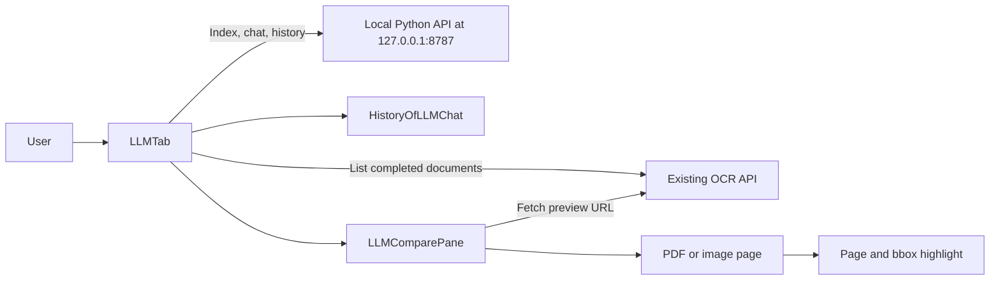

# Local Qwen document-Q&A frontend

This is the React/Vite user interface for the local multi-model document-Q&A application.
It lets the user browse completed OCR documents, select and index documents, ask
questions, inspect citations, compare answers with the cited source page, and
reopen saved conversations.

Run instructions for the frontend and backend are in
[`../Commands.md`](../Commands.md). Start the backend before starting the frontend.

## Browser request flow



`main.jsx` reads two Vite build-time environment variables:

| Variable | Local value | Purpose |
|---|---|---|
| `VITE_JRF_TASK_LLM_API_URL` | `http://127.0.0.1:8787/api` | Local Qwen/backend API. HTTP localhost is accepted only during Vite development. |
| `VITE_OCR_API_URL` | `https://o0dqnexpsg.execute-api.ap-southeast-2.amazonaws.com/prod` | Existing OCR service used for document lists and previews. |

The Vite app runs at `http://localhost:3000`. The backend must allow both
`http://localhost:3000` and `http://127.0.0.1:3000` through its local CORS setting.
The OCR service is a separate dependency; its CORS policy must also allow the
frontend origin for browser document-list and preview requests.

## Typical user workflow

1. `LLMTab` loads the completed OCR document list and every GGUF model the backend
   discovered in `LOCAL_MODEL_DIR`, including each file's name and size.
2. The user selects a document and requests indexing. The frontend sends its
   document ID to the backend and checks the returned job result.
3. The user checks one or more model cards and asks a question. For a comparison,
   each selected model receives the same retrieved passages and question in
   sequence.
4. The UI shows one clearly tagged result card per model, including its answer,
   citations, load time, and inference time. Opening a source loads its OCR preview,
   goes to the cited page, and overlays the normalized bbox when present.
5. `HistoryOfLLMChat` loads saved conversations from the local backend and can
   reopen an existing chat with its model selections and separately tagged answers.

The backend uses BM25 keyword search, not embeddings. Model comparisons run
sequentially and only one GGUF is kept loaded at a time to limit memory use. Figure
crops are not sent to the text models. See
[`../MainREADME.md`](../MainREADME.md) for the full OCR-to-answer flow.

## Frontend files

| File | Responsibility |
|---|---|
| `src/main.jsx` | Reads public Vite API URLs, allows a local HTTP backend only in Vite development, and mounts the UI. |
| `src/llmApi.js` | HTTP client for backend routes and the read-only OCR document/preview endpoints. |
| `src/components/LLMTab.jsx` | Main workspace: OCR document selection, model selection, indexing, chat, answer/citation display, and navigation to history/compare. |
| `src/components/HistoryOfLLMChat.jsx` | Lists saved conversations and loads their turns from backend history. |
| `src/components/LLMComparePane.jsx` | Fetches an OCR preview, renders a PDF page or image, and overlays the source bbox. |
| `src/components/llm.css` | Styles the workspace, chat/history panes, document compare view, and scrolling. |
| `package.json` | React, Vite, PDF renderer, and frontend scripts. |
| `package-lock.json` | Locked frontend dependency versions. |
| `index.html` | Vite HTML entry point for the React application. |

## Build

From this directory:

```bash
npm ci
npm run build
```

The production build requires an HTTPS backend URL. The local `http://127.0.0.1`
exception is restricted to Vite development mode.
