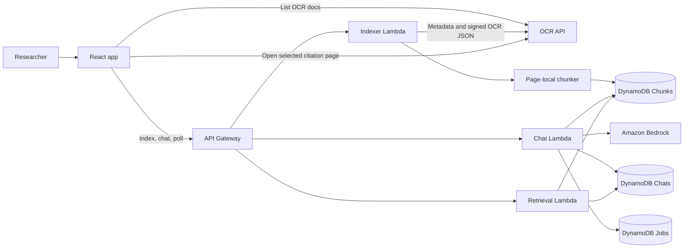
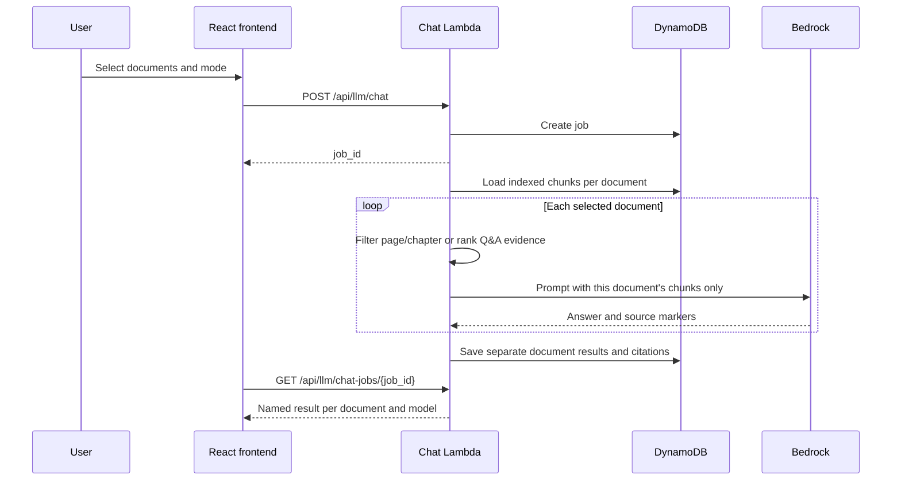

# jrf-task-llm-aws-plan

AWS serverless implementation of the BREATHE Document AI Chat system.
Replaces the local Python/GGUF stack with Lambda + Bedrock + DynamoDB.

Linked to the NLP Pipeline app — the "Chat with AI" button in Archive Lens opens this app.
Both apps share the same theme (Fraunces + DM Mono + #183a30 / #d46a46 palette).

## Architecture



The NLP/OCR pipeline owns source documents and OCR output. This app reads that
output through its API, persists searchable chunks and chat/job records, and never
mutates the OCR pipeline's storage.

---

## Folder structure

```
jrf-task-llm-aws-plan/
├── backend/
│   ├── chunker.py              Page-local text/table chunk creation
│   ├── bedrock_model.py        Bedrock prompts, inference, inline citations
│   ├── lambda_indexer.py       OCR fetch, chunk reuse/write, index job status
│   ├── lambda_chat.py          Per-document Q&A/summaries and chat job status
│   ├── lambda_retrieval_llm.py Health, models, history, chunk/status endpoints
│   └── tests/                  Retrieval, citation, mode, and chunker tests
│
└── frontend/
    ├── public/index.html
    ├── src/
    │   ├── index.jsx           React entry point
    │   ├── index.css           Global styles
    │   ├── App.jsx             App shell and Chat/History tabs
    │   ├── App.css             Shared app theme and layouts
    │   ├── llmApi.js           OCR/LLM API calls and job polling
    │   ├── documentTags.js     Document-tag filtering options
    │   └── components/
    │       ├── ChatTab.jsx        Document selection, chat and summaries
    │       ├── CitationPanel.jsx  PDF page and excerpt viewer
    │       └── HistoryTab.jsx     Chat history browser
    ├── .env.example
    └── package.json
```

---

## OCR indexing and chunking

Indexing reads the NLP pipeline's `/document/{document_id}` metadata and then fetches
the returned `ocr_presigned_url`. It uses the existing OCR schema: `elements` contain
page-local text and normalized bounding boxes; `tables` contain page-local rows and
bounding boxes. The chat app does not read or change the NLP pipeline's DynamoDB tables.

Chunks are built separately for each PDF page and capped at 2,800 characters
(`MAX_CHUNK_CHARS`). Table rows are converted to readable `cell | cell` text and
included with their page and table bounding box. Every chunk stores its document,
filename, tag, page, content type, bounding box, source hash, and chunker version.

The indexer reuses chunks when the OCR content hash and chunker version are unchanged;
it replaces them when the source or chunking format changes. Chat requests retrieve
from the selected documents' existing chunks; documents without an index are prepared
before the first answer. DynamoDB query responses are paginated.

```mermaid
sequenceDiagram
  participant UI as React frontend
  participant I as Indexer Lambda
  participant O as OCR API
  participant D as DynamoDB
  UI->>I: POST /api/llm/documents/index
  I->>D: Create indexing job
  I->>O: GET /document/{id}
  O-->>I: Metadata and OCR signed URL
  I->>O: GET signed OCR URL
  O-->>I: Page elements and tables
  I->>I: Hash, chunk, compare existing version
  I->>D: Reuse or replace chunks; update job
  UI->>I: Poll job status
```

The chat document picker filters by the same document tags as the database view,
including custom saved tags and untagged documents. Its `Chunked · DONE` badge is
derived from the persisted chunk rows in DynamoDB, so it remains accurate after reload.
When a user selects one or more documents, chat retrieval is limited to those documents.
Unchanged prepared documents are reused rather than re-indexed for each question.

Each factual sentence or bullet is prompted to cite its supporting page inline. The
backend normalizes markers against the evidence passed for that document, and each
answer carries its own citation list. A marker opens the source PDF at that page,
with the chunk's OCR/table bounding box and supporting excerpt.

Q&A and every summary mode run separately for each selected document. Each result
is shown in its own named section, carries citations only from that document, and
places citations beside supported claims rather than in a trailing list. Selected
documents are answered concurrently (up to four at once).
The document picker checks index state using DynamoDB count-only queries instead of
downloading every chunk just to show a status. PDF previews request byte ranges and
cache document metadata briefly to reduce repeat loading.

---

## Summarization modes

| Mode | Button label | What gets sent to the LLM |
|---|---|---|
| `chat` | Q&A Chat | Per-document BM25 top-K chunks matching the question |
| `summarize_doc` | Full Doc Summary | All chunks from one document at a time |
| `summarize_chapter` | Chapter-wise | All chunks from one selected document; asks the model to identify and summarize every detected chapter |
| `summarize_page` | Page Range | Chunks overlapping the validated requested page range |

Q&A and each summary mode process selected documents separately and render a named
answer card for each one, with only that document's retrieved evidence and citations.
Page-range summaries include only pages in the requested range. Chapter-wise mode
uses the complete selected document and asks for a separate summary of every chapter
the model can identify; it does not request or filter to a single chapter number.
Chunk-range mode is not available in the chat interface.

## Request and answer flow



### Per-document result contract

Each model result contains `document_summaries[]`. Every entry includes the
`document_id`, `filename`, answer `text`, and citations for that document only.
Citation source IDs (`src1`, `src2`, …) are assigned independently per document;
the frontend resolves each marker against the citation array on its own result.
Errors are also reported per document, so one unavailable chapter does not hide
successful results from the other selected documents.

### Lambda responsibilities

| Lambda | Purpose | Main steps |
|---|---|---|
| `lambda_indexer` | Prepare OCR documents for search | Fetch metadata and signed OCR JSON → hash OCR → chunk page text/tables → reuse or replace DynamoDB chunks → update job |
| `lambda_chat` | Answer and summarize selected documents | Validate/create job → load indexed chunks/history → isolate each document → select mode evidence → call Bedrock → persist results |
| `lambda_retrieval_llm` | Serve app metadata and saved data | Route GET requests → query model catalogue, chat history, chunk list, or index status → return JSON |

---

## AWS resources needed

### DynamoDB tables (ap-southeast-2, PAY_PER_REQUEST)

```
jrf-task-llm-Chunks
  PK: document_id (S)   SK: chunk_id (S)
  Attrs: filename, doc_tag, page, page_start, page_end, text, content_type,
         bbox, element_count, source_hash, chunker_version

jrf-task-llm-Chats
  PK: chat_id (S)   SK: turn_id (S)
  turn_id = "META" for header, "TURN#0001" etc for turns

jrf-task-llm-Jobs
  PK: job_id (S)
  TTL: set to 24h to auto-clean
```

### Lambda functions

| Function | Handler | Memory | Timeout | Zip contents |
|---|---|---|---|---|
| `jrf-task-llm-indexer` | `lambda_indexer.lambda_handler` | 512 MB | 120s | `lambda_indexer.py` + `chunker.py` |
| `jrf-task-llm-chat` | `lambda_chat.lambda_handler` | 512 MB | 60s | `lambda_chat.py` + `bedrock_model.py` |
| `jrf-task-llm-retrieval` | `lambda_retrieval_llm.lambda_handler` | 256 MB | 30s | `lambda_retrieval_llm.py` + `bedrock_model.py` |

### Environment variables

```
# Indexer
CHUNKS_TABLE       = jrf-task-llm-Chunks
JOBS_TABLE         = jrf-task-llm-Jobs
OCR_API_BASE_URL   = https://o0dqnexpsg.execute-api.ap-southeast-2.amazonaws.com/prod
MAX_CHUNK_CHARS    = 2800  # optional; chunker default
ALLOWED_ORIGIN     = https://your-llm-app-domain.com

# Chat
CHUNKS_TABLE       = jrf-task-llm-Chunks
CHATS_TABLE        = jrf-task-llm-Chats
JOBS_TABLE         = jrf-task-llm-Jobs
DEFAULT_TOP_K      = 5     # optional
MAX_TOP_K          = 8     # optional
ALLOWED_ORIGIN     = https://your-llm-app-domain.com

# Retrieval
CHUNKS_TABLE       = jrf-task-llm-Chunks
CHATS_TABLE        = jrf-task-llm-Chats
ALLOWED_ORIGIN     = https://your-llm-app-domain.com
```

`AWS_LAMBDA_FUNCTION_NAME` is supplied by Lambda and is used by the indexer and
chat worker for asynchronous self-invocation. `AWS_REGION` is supplied by Lambda;
model-specific Bedrock regions are configured in `bedrock_model.py`.

### API Gateway routes (add to existing jrf-task-ocr-api)

```
POST /api/llm/chat                          → jrf-task-llm-chat
GET  /api/llm/chat-jobs/{job_id}            → jrf-task-llm-chat
POST /api/llm/documents/index               → jrf-task-llm-indexer
GET  /api/llm/documents/index/{job_id}      → jrf-task-llm-indexer
GET  /api/llm/documents/{document_id}/chunks → jrf-task-llm-retrieval
GET  /api/llm/health                        → jrf-task-llm-retrieval
GET  /api/llm/models                        → jrf-task-llm-retrieval
GET  /api/llm/chats                         → jrf-task-llm-retrieval
GET  /api/llm/chats/{chat_id}               → jrf-task-llm-retrieval
```

---

## Frontend quick start

```bash
cd frontend
cp .env.example .env
# Edit .env — paste your API Gateway URL
npm install
npm start
```

---

## Linking from NLP Pipeline

In the NLP Pipeline's `App.js`, the "Chat with AI" tab should open this app's URL:

```js
// In NLP Pipeline App.js — replace the empty LLM tab with a redirect
{tab === 'llm' && (
  <div style={{ padding: '60px 0', textAlign: 'center' }}>
    <a
      href={process.env.REACT_APP_LLM_APP_URL}
      target="_blank"
      rel="noreferrer"
      className="process-button"
      style={{ display: 'inline-block', textDecoration: 'none' }}
    >
      Open Document AI Chat →
    </a>
  </div>
)}
```

Or open in the same window — both apps share the same theme so the transition is seamless.

---

## IAM permissions needed for Lambda execution role

```json
{
  "Effect": "Allow",
  "Action": [
    "dynamodb:GetItem", "dynamodb:PutItem", "dynamodb:UpdateItem",
    "dynamodb:Query", "dynamodb:Scan", "dynamodb:BatchWriteItem",
    "dynamodb:DeleteItem"
  ],
  "Resource": [
    "arn:aws:dynamodb:ap-southeast-2:931092012939:table/jrf-task-llm-*"
  ]
},
{
  "Effect": "Allow",
  "Action": ["bedrock:InvokeModel"],
  "Resource": [
    "arn:aws:bedrock:ap-southeast-2::foundation-model/*",
    "arn:aws:bedrock:us-west-2::foundation-model/*"
  ]
},
{
  "Effect": "Allow",
  "Action": ["lambda:InvokeFunction"],
  "Resource": ["arn:aws:lambda:ap-southeast-2:931092012939:function:jrf-task-llm-*"]
}
```

---

## Build order

1. Create 3 DynamoDB tables (Chunks, Chats, Jobs)
2. Create IAM role with above permissions
3. Zip + deploy `lambda_indexer` (chunker.py included)
4. Zip + deploy `lambda_chat` (bedrock_model.py included)
5. Zip + deploy `lambda_retrieval_llm` (bedrock_model.py included)
6. Add API Gateway routes
7. Set env vars on all 3 Lambdas
8. Deploy frontend (`npm run build` → S3 + CloudFront or Amplify)
9. Update NLP Pipeline `.env` with `REACT_APP_LLM_APP_URL`

## Local verification

```bash
cd backend
python3 -m unittest discover -s tests -p 'test_*.py' -v

cd ../frontend
npm run build
```

## Chat and model comparison

Normal chat selects exactly one model. The optional **Compare two models** panel
selects a second model and sends the same question and retrieved evidence to both;
answers render side by side. The backend enforces one model for normal chat and two
different allow-listed models for comparisons. Nova Lite and Nova Pro use Sydney;
Llama 3.1 8B uses `us-west-2` and needs Bedrock model access and IAM permission there.

The chat can select up to five documents. It isolates each document's chunks before
retrieval and inference, then keeps every answer and citation bound to that source
document and its PDF page.
